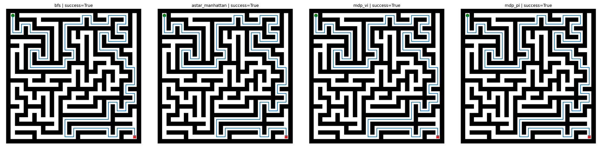
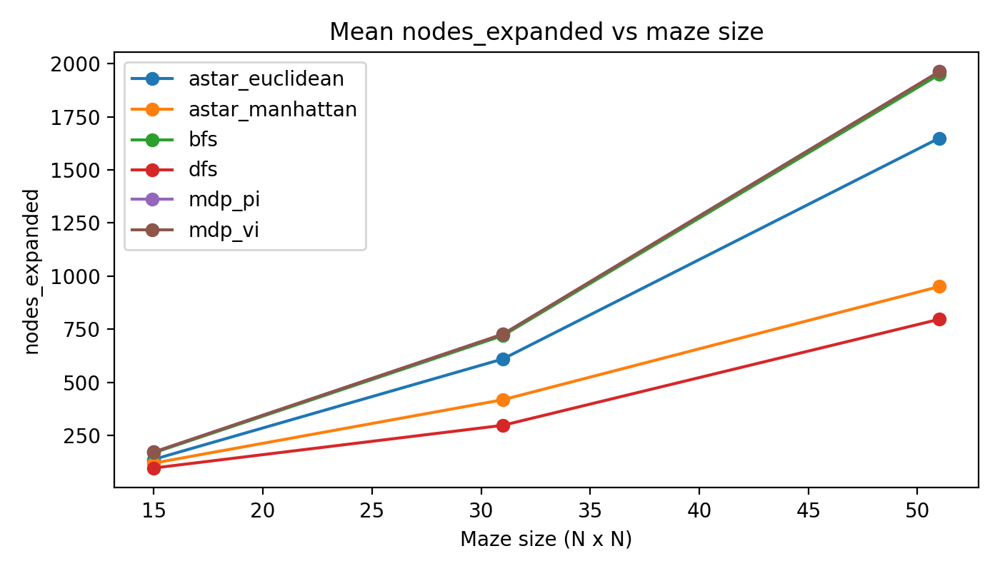

# Maze Search vs MDP

Classical search and Markov Decision Process planning, implemented from scratch and benchmarked on procedurally generated mazes up to 100 × 100.

[](https://github.com/leahweldon/Maze-Search-vs-MDP/actions/workflows/tests.yml)  



*One 30 × 30 maze, four solvers: BFS, A\* (Manhattan), Value Iteration and Policy Iteration all find a shortest path, at very different computational cost.*

When is it worth modelling a navigation problem as an MDP instead of just searching it? This project implements DFS, BFS, A\* (Manhattan and Euclidean heuristics), Value Iteration and Policy Iteration, then measures how each scales with maze size, structure, discount factor and transition uncertainty. Individual project for CS7IS2 Artificial Intelligence at Trinity College Dublin (2026).

## Results

**Search: nodes expanded on 50 × 50 random mazes** (wall density 0.25, mean of 5 seeds)

| Algorithm | Nodes expanded | Shortest path? |
|---|---:|:---:|
| DFS | 789.4 | No |
| BFS | 1,873.6 | Yes |
| A\* (Euclidean) | 1,588.4 | Yes |
| **A\* (Manhattan)** | **986.4** | **Yes** |

**MDP: runtime on 50 × 50 perfect mazes** (γ = 0.95, deterministic transitions)

| Algorithm | Runtime |
|---|---:|
| **Value Iteration** | **424.8 ms** |
| Policy Iteration | 1,076.4 ms |



## Key findings

1. **The right heuristic halves the work.** Manhattan A\* expands 47% fewer nodes than BFS while still guaranteeing the shortest path. Euclidean A\* is admissible too, but it underestimates distance on a 4-connected grid, so it explores far more.
2. **Search wins on deterministic navigation.** Search finds one path; an MDP computes an optimal action for *every* cell. That's wasted effort when moves always succeed, and exactly what you need when they don't.
3. **Uncertainty is expensive.** Adding a 10% chance of slipping sideways made Policy Iteration about 6× slower on 20 × 20 mazes (54 ms → 321 ms), and Value Iteration's iteration count rose from about 107 to over 166 at 70% reliability.
4. **Value Iteration beats Policy Iteration under deterministic transitions**, running about 2.5× faster at 50 × 50. As γ approaches 1, both slow down as convergence weakens.

## How it works

| Component | Source | Notes |
|---|---|---|
| Maze generation | [`src/maze/`](src/maze/) | Seeded perfect mazes and random mazes with configurable wall density |
| DFS, BFS | [`src/solvers/dfs.py`](src/solvers/dfs.py), [`bfs.py`](src/solvers/bfs.py) | Stack and queue frontiers with path reconstruction |
| A\* | [`src/solvers/astar.py`](src/solvers/astar.py) | Priority queue with Manhattan or Euclidean heuristic |
| Value / Policy Iteration | [`src/solvers/mdp_value_iter.py`](src/solvers/mdp_value_iter.py), [`mdp_policy_iter.py`](src/solvers/mdp_policy_iter.py) | Bellman updates, greedy policy extraction, optional slip model |
| Experiments | [`src/experiments/`](src/experiments/), [`config/experiments.yaml`](config/experiments.yaml) | YAML presets, multi-seed sweeps, metric aggregation and plotting |
| CLI | [`src/cli.py`](src/cli.py) | Generate, solve, animate, export solutions and run experiments |

**MDP model:** reward −1 per step and 0 at the goal. With `p_intended < 1`, the agent moves as intended with that probability and otherwise slips to one of the two perpendicular directions; moves into walls leave it in place.

**Metrics recorded:** runtime, nodes expanded, maximum frontier size, path length, MDP iterations, success rate and optional peak memory.

## Getting started

Requires Python 3.12+.

```bash
python3 -m venv .venv
source .venv/bin/activate
pip install -r requirements.txt
PYTHONPATH=src:. python -m pytest -q tests
```

Generate a maze and solve it:

```bash
PYTHONPATH=src:. python -m src.cli generate --type random --width 21 --height 21 \
  --density 0.25 --seed 1 --out maze.json

PYTHONPATH=src:. python -m src.cli solve --maze maze.json --algo astar_manhattan
```

```text
Success:   True
Runtime:   0.439 ms
Expanded:  170
Frontier:  32
Path len:  40
```

Other algorithms: `dfs`, `bfs`, `astar_euclidean`, `mdp_vi` and `mdp_pi` (with `--gamma`, `--theta` and `--p-intended`). Run `PYTHONPATH=src:. python -m src.cli --help` for animation, solution export and experiment commands; [`readme.txt`](readme.txt) has the full command reference.

## Repository structure

```text
├── src/
│   ├── maze/              # Generation, grid model, I/O, rendering
│   ├── solvers/           # DFS, BFS, A*, Value Iteration, Policy Iteration
│   ├── experiments/       # Runners, presets, analysis, figure generation
│   ├── heuristics.py
│   ├── metrics.py
│   └── cli.py
├── tests/
├── config/experiments.yaml
├── results/raw/           # Selected CSVs behind the report's figures
├── report/figures/        # Report figures
└── docs/
    └── Maze-Search-vs-MDP-Report.pdf
```

## Report

The full 38-page report covers the algorithm design, experimental setup, results for every configuration, discussion and code appendices: **[Maze-Search-vs-MDP-Report.pdf](docs/Maze-Search-vs-MDP-Report.pdf)**

## License

[MIT](LICENSE) © Leah Weldon
